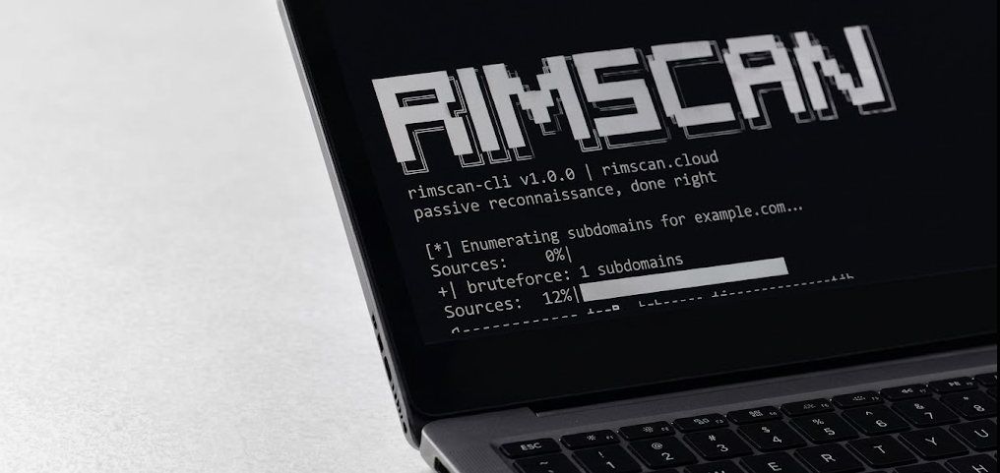

# Rimscan CLI


Rimscan CLI is a standalone, database-free reconnaissance tool for authorized
security testing. It discovers subdomains, resolves DNS and CNAME chains,
audits DNS and TLS configuration, checks for common exposed secrets, and
identifies possible subdomain takeover candidates using public fingerprints.

**Only scan domains you own or have explicit written permission to test.**
This tool is not a license to scan arbitrary third-party infrastructure.

## Installation

Requires Python 3.9 or newer.

```bash
python -m venv .venv
# Windows: .venv\Scripts\activate
source .venv/bin/activate
python -m pip install .
```

This installs the `rimscan-cli` command. `python -m rimscan_cli` works as well.

## Usage

```bash
rimscan-cli scan example.com
rimscan-cli scan example.com --output results.json
rimscan-cli scan example.com --authorized --secrets
rimscan-cli scan example.com --authorized --zone-transfer --nuclei
rimscan-cli scan example.com --quiet --fail-on high    # CI use
```

Results are written to **stdout as JSON** (or to a file with `--output`).
The banner, progress lines and the findings summary go to **stderr**, so
`rimscan-cli scan example.com | jq .` always receives clean JSON. Use
`--quiet` to silence stderr completely.

### Options

| Option | Description |
| --- | --- |
| `--authorized` | Confirm you own the target or may test it. Required by `--secrets`, `--zone-transfer` and `--nuclei`. |
| `--secrets` | Fetch a fixed list of well-known paths (`/.env`, `/config.js`, ...) and look for exposed credentials. |
| `--zone-transfer` | Attempt an AXFR against the domain's nameservers. |
| `--nuclei` | Run [Nuclei](https://github.com/projectdiscovery/nuclei) (installed separately) with `-etags dos,fuzz,intrusive`. |
| `--nuclei-rate-limit N` | Nuclei requests per second (default 75). |
| `--bruteforce` | Also resolve a short list of common subdomain names. |
| `--no-certs` | Skip the TLS certificate audit. |
| `--sources LIST` | Comma-separated enumeration sources (default: all). |
| `--resolver IPS` | Comma-separated DNS resolver addresses (default: system resolver). |
| `--timeout SECONDS` | Network timeout (default 10). |
| `-o`, `--output FILE` | Write JSON to a file instead of stdout. |
| `--fail-on LEVEL` | Exit with status 1 if any finding is at or above `info`, `low`, `medium`, `high` or `critical`. |
| `-q`, `--quiet` | No banner, progress or summary. |
| `--no-banner` | Do not print the banner. |
| `--verbose` | Debug logging. |

### Exit codes

| Code | Meaning |
| --- | --- |
| 0 | Scan finished (and no finding reached `--fail-on`). |
| 1 | A finding at or above the `--fail-on` severity was reported. |
| 2 | Invalid arguments, a missing `--authorized`, or an output file that could not be written. |
| 130 | Interrupted. |

### Output

The JSON document contains `domain`, `wildcard_dns`, `sources` (the outcome of
each enumeration source), `subdomains`, `resolutions`, `takeover_findings`,
`dns_findings`, and, when enabled, `certificate_findings`, `secret_findings`
and `nuclei`. Secret values are always redacted in the output.

## Data sent to third parties

To find subdomains, the target domain name is sent to these public services:

- [crt.sh](https://crt.sh)
- [Cert Spotter](https://sslmate.com/certspotter)
- [AlienVault OTX](https://otx.alienvault.com)
- [RapidDNS](https://rapiddns.io)
- [Wayback Machine](https://web.archive.org)
- [Anubis (jldc.me)](https://jldc.me)

Use `--sources` to choose a subset. The tool identifies itself with the
User-Agent `rimscan-cli/<version> (+https://rimscan.cloud)`. Nothing is sent
to Rimscan or any other server.

## Scope and safety

This tool combines public data sources with direct network checks:

- **Default scan:** DNS lookups, TLS handshakes with discovered hosts, and at
  most one HTTP request (HTTPS, then HTTP) to hosts whose CNAME points at a known
  third-party service, to check takeover fingerprints.
- **`--bruteforce`:** DNS lookups for a short wordlist.
- **`--secrets`:** GET requests for a fixed list of common paths on every live host.
- **`--zone-transfer`:** AXFR requests to the domain's nameservers.
- **`--nuclei`:** the separately installed Nuclei scanner, which sends active
  probes. Excluding the `dos`, `fuzz` and `intrusive` tags is not a guarantee
  that every template is passive.

Use it only against targets you are explicitly authorized to test. Respect
provider terms, rate limits, and the scope of the authorization you received.

The standalone CLI does not include Katana crawling, deep-scan tags, fuzzing,
SQL injection or XSS templates, SaaS authentication, billing, quotas,
notifications, a dashboard, Postgres, Redis, or Celery.

## Rimscan — the hosted platform

`rimscan-cli` is a command-line tool. It runs locally, on demand, from your
terminal and performs one-off reconnaissance: subdomain enumeration, DNS and
certificate audits, secret exposure checks, and subdomain takeover detection.

[Rimscan](https://rimscan.cloud) is the hosted web platform built around this
engine. It is not a CLI: you sign up, add a domain through the dashboard, and
Rimscan handles scanning continuously instead of requiring you to run commands
yourself.

Rimscan adds:

- **Continuous monitoring** — targets are automatically re-scanned roughly
  every two days, so new exposures can be caught without remembering to run
  the CLI again.
- **Deep Scan (active testing)** — active crawling via Katana and payload-based
  testing for vulnerabilities such as SQL injection and XSS. This is
  intentionally outside the scope of this CLI.
- **Centralized dashboard** — domains, scan history, and findings in one place
  instead of scattered JSON output files.
- **Findings management** — severity breakdowns, CVE identification, and a
  triage workflow for marking findings as resolved or false positive.
- **Team-friendly workflows** — ongoing visibility across multiple domains for
  companies and security teams, rather than only one-off researcher scans.
- **Email alerts** — notifications when new findings are discovered, instead
  of requiring manual checks.

`rimscan-cli` shares Rimscan's core reconnaissance engine. If you like what it
finds, Rimscan is built for teams that want that coverage running continuously
and automatically, not only when someone remembers to run a command.

Rimscan is available now at [rimscan.cloud](https://rimscan.cloud).

## Development

```bash
python -m pip install -e ".[dev]"
python -m pytest
```

The test suite runs offline: all network and DNS access is mocked.

## License

This project is source-available under the Elastic License 2.0. See
[LICENSE](LICENSE) for the complete license text. The takeover fingerprints are
sourced from [can-i-take-over-xyz](https://github.com/EdOverflow/can-i-take-over-xyz);
review that project's terms before redistributing the fingerprint data.
